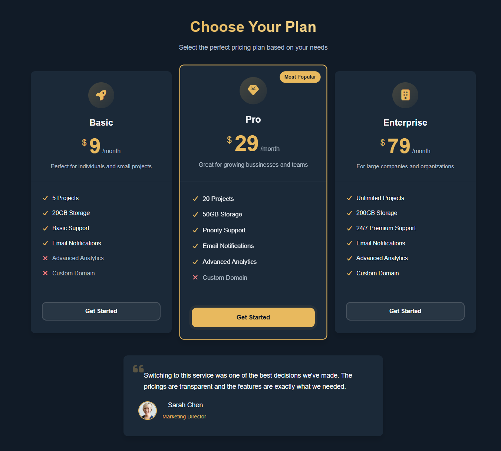
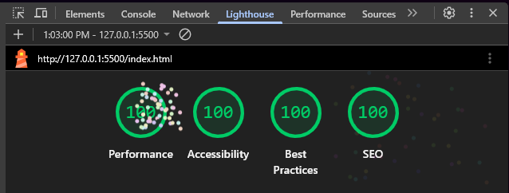

# Pricings

A responsive static pricing page built with HTML and CSS. It highlights three subscription tiers, a featured Pro plan, and a customer testimonial in a dark, premium layout.

## Preview

## Performance metrics
Performance metrics in development

It feels good to have 100 in all metrics😎

## Project files

- `index.html` – page structure and content
- `style.css` – visual styling, layout, and interactions